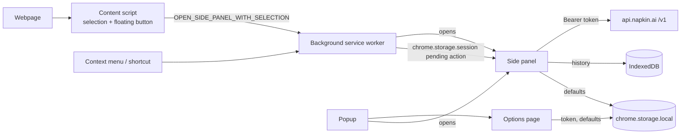

# Napkin Companion

A Chrome extension (Manifest V3) that turns selected webpage text into [Napkin](https://www.napkin.ai/) visuals from a side panel, without leaving the page you are reading.

> Unofficial project. Not affiliated with, endorsed by, or maintained by Napkin. It requires your own Napkin API token, and Napkin's API is invite-only at the time of writing.

## Overview

Select text on a page, click the floating **Generate with Napkin** button (or use the right-click menu), and the text is sent to the side panel. From there it is submitted to the Napkin API, and the generated visuals can be copied or downloaded and are kept in a local history.

## Features

Verified by reading the code. Nothing has been exercised in a live browser or against the live Napkin API (see [Limitations](#limitations)).

- Floating "Generate with Napkin" button on text selection (content script, rendered in a shadow root)
- Right-click context menu: "Generate with Napkin"
- Side panel with editable text, style picker (15 built-in styles), format picker (SVG / PNG / PPT), cancel during generation
- Requests 3 visual options per generation; polls Napkin until done, with backoff
- Copy and Download for each result
- Local history (IndexedDB): search, favorite, delete individual items
- Options page: API token save/remove/test connection, default style, default format
- Readable error and warning messages mapped from Napkin API error codes
- Keyboard shortcut `Ctrl+Shift+N` (`Command+Shift+N` on macOS) opens the side panel

## Technology Stack

JavaScript (ES modules), HTML, CSS, Chrome Extension APIs (Manifest V3, side panel, context menus, storage, commands), the Napkin REST API. The shipped code is a Vite-style build of a React 18 + Tailwind CSS application; **the original source is not in this repository** (see [Limitations](#limitations)).

## Architecture



- **Background service worker** (`src/background/index.js`): creates the context menu, handles the shortcut, validates selection messages from the content script, stores the pending action in session storage and opens the side panel.
- **Content script** (`src/content/index.js`): detects text selection and shows the floating button. Page text is only sent when you click it.
- **Popup**: shows whether a token is configured; opens the side panel or settings.
- **Side panel**: generation UI, results, history.
- **Options page**: token and default settings.
- **Storage**: token and settings in `chrome.storage.local`; pending action in `chrome.storage.session`; history in IndexedDB.

## Project Structure

```
extension/            Load this folder in Chrome
  manifest.json
  src/{background,content,popup,sidepanel,options}/   entry points (compiled output)
  src/assets/         icons
  assets/             shared compiled chunks and CSS
scripts/check.mjs         static manifest/asset/host checks
scripts/test-patches.mjs  tests for the security patches
SECURITY.md  CONTRIBUTING.md  THIRD_PARTY_NOTICES.md  docs/AUDIT.md
```

## Installation

1. Clone the repository.
2. No dependencies are needed to load the extension.
3. Open `chrome://extensions`, enable **Developer mode**, click **Load unpacked**, select the `extension/` folder.
4. A Chromium version with the side panel API is required (Chrome 114+).
5. Open the extension's **Settings** and add your Napkin API token.

## Configuration

Get a token at app.napkin.ai → Account Settings → Developers, paste it into the Settings page and use **Test connection**. There is no `.env` support; configuration is entirely in the Settings page. Never commit a real token.

## Usage

Select text on a page and click **Generate with Napkin**, or right-click the selection. The side panel opens with the text filled in; press **Generate**. The toolbar icon opens the popup, which can open the side panel directly.

## Permissions

| Permission | Why |
| --- | --- |
| `storage` | Token, settings, pending selection |
| `contextMenus` | Right-click entry |
| `sidePanel` | Side panel UI |
| `activeTab` | Retained from the original manifest; likely removable, untested |
| Host `https://api.napkin.ai/*` | Napkin API calls |
| Content script on all sites (except Napkin's) | Detect selections and show the floating button |

## Security and Privacy

- Selected text and its page URL are sent to `api.napkin.ai` when you press Generate. Nothing else is sent anywhere; no analytics.
- Your token is stored in `chrome.storage.local`, which is **not encrypted**. Remove it from Settings. Uninstalling the extension deletes its storage.
- History (source text, page URL, generated files) is stored locally in IndexedDB until you delete items. There is no "clear all" yet.
- The token is attached only to requests to `https://api.napkin.ai`.

See [SECURITY.md](SECURITY.md) and [docs/AUDIT.md](docs/AUDIT.md).

## Limitations

- **No original source or build config** (no TSX, `package.json`, Vite/Tailwind config). The project cannot be rebuilt from this repository, and edits are made directly to compiled output.
- **Content script likely does not load**: it uses static `import` statements and the manifest has no `web_accessible_resources`. Chrome content scripts are classic scripts, so the floating button probably fails. Not confirmed in a browser. The context menu path does not depend on it.
- `Ctrl+Shift+N` opens the side panel but does not pass the selection (the side panel ignores that message type).
- Surrounding-heading context is collected by the content script but dropped before generation.
- Settings `smartDetectionEnabled`, `floatingButtonPosition` and `theme` are stored but have no effect.
- Copy fails silently for formats the clipboard does not accept (e.g. SVG, PPT).
- Depends on Napkin's invite-only API; availability, credits and rate limits are Napkin's.
- Not tested in a live browser or against the live API.

## Future Improvements

Recover or recreate the source and a reproducible build; bundle the content script as a single script; wire up or remove the unused settings; pass selection on shortcut; "clear history"; accessible labels and focus states audit; narrow site access (e.g. `activeTab` only).

## Contributing

See [CONTRIBUTING.md](CONTRIBUTING.md).

## License

No license has been applied. Choose one before publishing. React's MIT notice is preserved in the bundle; see [THIRD_PARTY_NOTICES.md](THIRD_PARTY_NOTICES.md).

## Author

Add your approved professional details here.
